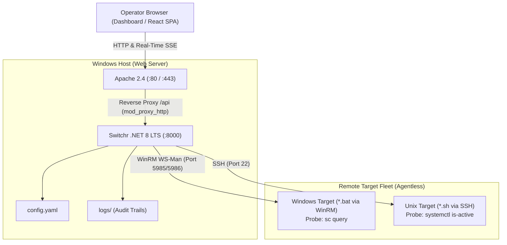

# Switchr — Remote Service Configuration Orchestrator

A lightweight, agentless Windows-hosted application for orchestrating configuration profile changes and service restarts across heterogeneous Windows and Unix application servers via an intuitive web dashboard.



---

## Key Features

- **Agentless Execution**: Zero software, agents, or background daemons installed on remote target hosts. Orchestrates existing batch scripts (`*.bat` on Windows) and shell scripts (`*.sh` on Unix).
- **Self-Contained .NET 8 LTS Backend**: Compiles to a single standalone executable (`Switchr.exe`) with zero runtime dependencies (no Python or Node.js required in production).
- **Native Windows Service Integration**: Built-in Windows Service lifecycle support via `Microsoft.Extensions.Hosting.WindowsServices` (`UseWindowsService()`), eliminating the need for external service wrappers like NSSM.
- **In-Process PowerShell & SSH Remoting**:
  - Windows targets: Native WinRM execution and pipeline streaming using Microsoft's `System.Management.Automation`.
  - Unix targets: Pure managed SSH execution using `SSH.NET` (`Renci.SshNet`).
- **Real-Time Log Streaming**: Streams remote `stdout` and `stderr` line-by-line to the browser in real time via **Server-Sent Events (SSE)** through unbuffered Apache `mod_proxy_http` (`flushpackets=on`).
- **Operational Safety**:
  - **In-Memory Concurrency Lock**: Strict mutex lock per `(host_id, service_id)` preventing concurrent switches on the same service (returns `HTTP 409 Conflict`).
  - **Post-Transition Verification Probes**: Automatically validates service running health (`sc query <svc>` on Windows, `systemctl is-active <svc>` on Unix) before marking a job successful.
  - **Fail-Fast**: Immediately halts and marks jobs `FAILED` on non-zero exit codes with full diagnostic logs surfaced.
  - **Operator Abort**: Operators can cancel long-running or unresponsive jobs on demand (`POST /api/jobs/{id}/abort`).
- **Comprehensive Audit Trails**: Every switch action, operator trigger, start/end timestamp, exit code, and captured terminal output is persisted to disk in `logs/`.
- **Dry-Run Simulation**: Built-in mock mode (`dry_run: true`) simulating realistic command execution and log streaming for safe testing and demonstrations.
- **Dual UI Dashboards**:
  - **Standalone Dashboard**: Zero-build single-page application in `static/index.html` and `Switchr/wwwroot/index.html` (Tailwind CSS via CDN, vanilla JS, SSE terminal).
  - **React SPA**: Feature-rich dashboard in `src/` (Vite, React, TypeScript, Tailwind CSS, modal dialogs, terminal drawer, and audit history).

---

## Project Structure

```
Switchr/
├── Switchr/                         # C# .NET 8 LTS Backend Application
│   ├── Models/
│   │   └── ConfigModels.cs          # YAML schema & API DTOs
│   ├── Services/
│   │   ├── Executors/
│   │   │   ├── ICommandExecutor.cs  # Abstract streaming execution interface
│   │   │   ├── MockExecutor.cs      # Dry-run simulation executor
│   │   │   ├── SshExecutor.cs       # Unix SSH executor (SSH.NET)
│   │   │   └── WinRmExecutor.cs     # Windows WinRM executor (PowerShell SDK)
│   │   └── JobManager.cs            # Mutex locks, SSE streaming hub, audit writer
│   ├── wwwroot/
│   │   └── index.html               # Embedded standalone dashboard
│   ├── appsettings.json             # ASP.NET Core settings
│   ├── Program.cs                   # Minimal API endpoints & Windows Service bootstrap
│   └── Switchr.csproj               # Project configuration
├── Switchr.Tests/                   # Automated xUnit Test Suite
│   ├── ConfigTests.cs               # YAML deserialization tests
│   └── JobManagerTests.cs           # Mutex locking, streaming & abort tests
├── src/                             # React SPA Frontend (Vite, React, TypeScript)
│   ├── components/                  # FleetView, TerminalDrawer, ConfirmModal, AuditHistoryView
│   ├── services/                    # Client-side API / mock orchestrator
│   └── types.ts                     # TypeScript domain models
├── static/                          # Standalone single-page operator dashboard
│   └── index.html                   # Zero-build HTML/Tailwind/Vanilla JS dashboard
├── docs/
│   ├── adr/                         # Architectural Decision Records (ADRs 0001 - 0006)
│   └── AI_STUDIO_PROMPT.md          # Google AI Studio specification prompt
├── config.yaml                      # Declarative fleet inventory and service profiles
├── apache_vhost.conf                # Apache 2.4 VirtualHost configuration
├── GLOSSARY.md                      # Ubiquitous domain terminology
├── Switchr.sln                      # Visual Studio Solution
└── package.json                     # Vite / React frontend dependencies
```

---

## Getting Started

### 1. Configure Environment Credentials
Target passwords are evaluated securely from machine or process environment variables as referenced by `password_env` in `config.yaml`:

```powershell
# In an elevated PowerShell prompt:
[System.Environment]::SetEnvironmentVariable('WIN_CORE_PASSWORD', 'YourSecurePassword!', 'Machine')
[System.Environment]::SetEnvironmentVariable('WIN_STAGE_PASSWORD', 'YourStagingPassword!', 'Machine')
```

### 2. Run in Development Mode
To run the .NET 8 backend:
```powershell
cd Switchr
dotnet run --urls=http://127.0.0.1:8000
```
Open `http://127.0.0.1:8000` in your browser. (By default, `dry_run: true` is configured in `config.yaml` to simulate executions safely).

To run the React development server:
```powershell
npm install
npm run dev
```

### 3. Run Automated Tests
```powershell
dotnet test Switchr.sln
```

### 4. Build Self-Contained Release Executable
```powershell
dotnet publish Switchr\Switchr.csproj -c Release -r win-x64 --self-contained true -p:PublishSingleFile=true -o publish
```
The output directory `publish/` contains a standalone, single-file `Switchr.exe` ready for production deployment.

---

## Deployment on Windows Server with Apache 2.4

### 1. Register as a Native Windows Service
Because `Switchr.exe` includes built-in Windows Service integration via `UseWindowsService()`, it can be registered directly with the Windows Service Controller (`sc.exe`):

```powershell
# In an elevated PowerShell prompt:
sc.exe create Switchr binPath= "C:\Services\Switchr\publish\Switchr.exe" start= auto
sc.exe description Switchr "Switchr Remote Service Configuration Orchestrator"
sc.exe start Switchr
```

### 2. Configure Apache 2.4 Reverse Proxy
1. Ensure the following modules are loaded in `C:\Apache24\conf\httpd.conf`:
   ```apache
   LoadModule proxy_module modules/mod_proxy.so
   LoadModule proxy_http_module modules/mod_proxy_http.so
   LoadModule headers_module modules/mod_headers.so
   LoadModule rewrite_module modules/mod_rewrite.so
   ```
2. Include the virtual host configuration:
   ```apache
   Include conf/extra/switchr_vhost.conf
   ```
3. Copy `apache_vhost.conf` to `C:\Apache24\conf\extra\switchr_vhost.conf`.
4. Restart Apache (`httpd -k restart`).

---

## REST API Reference

| Endpoint | Method | Request Payload | Description |
| :--- | :--- | :--- | :--- |
| `/api/inventory` | `GET` | — | Returns target fleet inventory, managed services, active profiles, and active concurrency locks. |
| `/api/jobs/switch` | `POST` | `{"host_id": "...", "service_id": "...", "profile_name": "..."}` | Initiates a configuration switch. Returns `{ "job_id": "..." }` or `HTTP 409 Conflict` if the service is locked. |
| `/api/jobs/{id}/abort` | `POST` | — | Sends a cancellation signal to a running switch job. |
| `/api/jobs/{id}/stream` | `GET` | — | Server-Sent Events (SSE) endpoint streaming live console lines (`text/event-stream`). |
| `/api/jobs/history` | `GET` | — | Returns persistent execution history and audit records from disk. |
